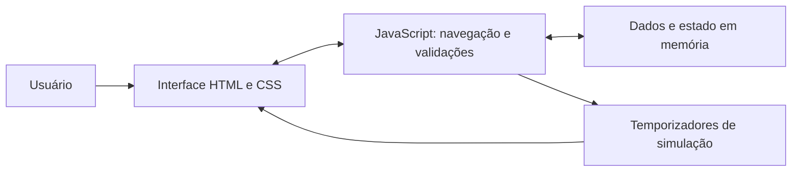

<div align="center">

# 🌾 AgroEncomenda

**Do produtor para o comércio e para a sua mesa.**

Protótipo acadêmico de uma plataforma de conexão entre produtores rurais, comércios e consumidores de Uberaba e região do Triângulo Mineiro.

**HTML5 · CSS3 · JavaScript · Licença MIT**

[Sobre](#sobre-o-projeto) · [Funcionalidades](#funcionalidades) · [Executar](#como-executar) · [Documentação](#documentação) · [Contribuir](CONTRIBUTING.md)

</div>

> **Status: demonstração acadêmica.** O sistema simula negociações, mensagens e acompanhamento de pedidos. Não realiza vendas, pagamentos ou entregas reais. Não possui backend nem banco de dados conectado.

## Sumário

- [Sobre o projeto](#sobre-o-projeto)
- [Público-alvo](#público-alvo)
- [Funcionalidades](#funcionalidades)
- [Tecnologias](#tecnologias)
- [Como executar](#como-executar)
- [Roteiro rápido de demonstração](#roteiro-rápido-de-demonstração)
- [Estrutura do repositório](#estrutura-do-repositório)
- [Arquitetura e dados](#arquitetura-e-dados)
- [Documentação](#documentação)
- [Limitações atuais](#limitações-atuais)
- [Próximos passos sugeridos](#próximos-passos-sugeridos)
- [Contribuição e autoria](#contribuição-e-autoria)
- [Licença](#licença)

## Sobre o projeto

O AgroEncomenda foi desenvolvido como trabalho A3 de Projeto e Engenharia de Software. Sua proposta é aproximar quem produz alimentos de quem deseja comprar para consumo próprio ou abastecer um comércio.

O protótipo apresenta produtos, vitrines de produtores, preços de varejo e atacado, demandas de compradores e propostas de negociação. O pagamento e a logística fazem parte da representação do acordo direto entre as partes; não há intermediação financeira implementada.

### Objetivos

- Dar visibilidade aos produtos e produtores da região.
- Facilitar a consulta de preços, quantidades e modalidades de retirada ou entrega.
- Demonstrar a negociação de pedidos e o atendimento a encomendas.
- Aplicar conceitos de interface web, requisitos e modelagem relacional.

## Público-alvo

| Perfil | Uso previsto na proposta |
| --- | --- |
| Produtor | Apresentar produtos, manter uma vitrine e negociar com compradores. |
| Comércio | Encontrar fornecedores, consultar atacado e solicitar abastecimento. |
| Consumidor | Consultar produtos e negociar compras diretamente com produtores. |

Os três perfis podem ser escolhidos no cadastro demonstrativo. Os catálogos e vitrines são pré-carregados; criar uma conta não publica uma nova vitrine ou produto.

## Funcionalidades

| Recurso | Situação no protótipo |
| --- | --- |
| Página inicial | Apresentação, indicadores e quadro de preços a partir dos dados de exemplo. |
| Catálogo de produtos | Seis produtos com preço, unidade, quantidade, origem e categoria. |
| Preços para comércio | Alternância entre varejo e atacado, com quantidade mínima quando cadastrada. |
| Detalhes do produto | Informações do produtor e acesso às ações de pedido e pergunta. |
| Produtores e vitrines | Três produtores de exemplo, com seus produtos e formas de atendimento. |
| Cadastro e login | Validações locais e criação de um usuário temporário, sem autenticação real. |
| Pedido/proposta | Formulário com quantidade, valor, data, transporte e pagamento combinado. |
| Encomendas | Consulta de uma demanda pré-carregada e envio simulado de proposta. |
| Acompanhamento | Evolução automática dos estados da proposta no painel. |
| Perguntas | Envio local e resposta automática de demonstração. |
| Interface adaptável | CSS com ajustes para telas menores e preferência por movimento reduzido. |

## Tecnologias

| Tecnologia | Aplicação |
| --- | --- |
| HTML5 | Estrutura das telas e formulários. |
| CSS3 | Identidade visual, grades, componentes e responsividade. |
| JavaScript puro | Navegação, renderização, validações e simulações. |
| Google Fonts | Fontes Fraunces e Figtree; o carregamento depende de conexão. |
| Git e GitHub | Versionamento e distribuição do projeto. |

Não há framework, gerenciador de pacotes, etapa de build ou configuração de variáveis de ambiente.

## Como executar

### Opção 1 — abrir no navegador

1. Baixe este repositório em **Code → Download ZIP** e extraia os arquivos.
2. Abra a pasta `src`.
3. Abra `index.html` em um navegador atualizado.

O código está disponível diretamente na pasta [src/](src/), sem ZIP interno. Abra os arquivos para visualizar ou editar HTML, CSS e JavaScript pelo GitHub ou pelo seu editor.

### Opção 2 — servidor local com Python

Com Python 3 instalado, execute na raiz do projeto:

```bash
python -m http.server 8000 --bind 127.0.0.1 --directory src
```

Abra [http://localhost:8000](http://localhost:8000). Para encerrar, pressione `Ctrl+C` no terminal. Python é opcional e serve apenas para disponibilizar os arquivos localmente.

### Obter a versão do GitHub

```bash
git clone https://github.com/templaspreguissa/AgroEncomenda.git
cd AgroEncomenda
```

Após o clone, abra `src/index.html` ou execute o servidor local descrito acima.

## Roteiro rápido de demonstração

1. Na tela **Produtos**, clique em **Simular uma compra**.
2. O sistema cria um visitante demonstrativo e abre o pedido de ovos caipiras.
3. Informe quantidade, preço e uma data futura; envie a proposta.
4. Feche a mensagem de confirmação, se necessário, e acompanhe **Meu Painel**.
5. Uma oferta de pelo menos 85% do preço de referência é aceita automaticamente. O fluxo avança por **Aceita**, **Pagamento combinado**, **A caminho** e **Entregue**, em aproximadamente 16 segundos após o envio.
6. Para observar uma recusa, envie uma nova oferta abaixo desse limite.
7. Abra uma vitrine, envie uma pergunta com pelo menos cinco caracteres e confira a resposta automática no painel após cerca de seis segundos.

Use informações fictícias. Recarregar a página reinicia os dados alterados durante a demonstração.

Consulte o [roteiro de verificação manual](docs/TESTES.md) para outros cenários.

## Estrutura do repositório

```text
AgroEncomenda/
├── README.md                   # Apresentação e guia principal
├── LICENSE                     # Licença MIT
├── CONTRIBUTING.md             # Orientações de contribuição
├── src/                       # Código-fonte da aplicação
│   ├── index.html              # Telas e formulários
│   ├── style.css               # Estilos e responsividade
│   ├── script.js               # Dados e lógica da demonstração
│   └── README.md               # Guia local de execução
├── docs/
│   ├── ARQUITETURA.md          # Organização do código e modelo de dados
│   └── TESTES.md               # Roteiro manual e resultados esperados
└── AgroEncomenda/              # Diagramas e documentação acadêmica
    ├── Diagrama de caso de uso.jpg
    ├── Entidade de Relacionamento.jpg
    ├── Dicionário de Dados.pdf
    ├── Documentação Banco de Dados AgroEncomenda.pdf
    ├── Modelo Relacional + Normalização (3FN).pdf
    └── agroencomenda-todas-as-paginas (1).pdf
```

## Arquitetura e dados

A aplicação funciona inteiramente no navegador. O HTML contém as seções das telas; o JavaScript alterna a classe `ativa` para exibir a seção solicitada e atualiza o conteúdo por manipulação do DOM.



Produtos, produtores e encomendas são definidos em arrays no `script.js`. Usuário, propostas e perguntas permanecem somente na memória da página: não há uso de `localStorage`, `sessionStorage`, API ou persistência em banco.

A documentação propõe sete entidades para uma evolução com banco relacional: **Usuario, Vitrine, Categoria, Produto, Encomenda, Proposta e Mensagem**. Os documentos incluem chaves, relacionamentos e critérios de normalização até a terceira forma normal (3FN), mas não incluem scripts SQL executáveis.

Mais detalhes e divergências a conciliar estão em [Arquitetura](docs/ARQUITETURA.md).

## Documentação

| Material | Conteúdo |
| --- | --- |
| [Diagrama de caso de uso](AgroEncomenda/Diagrama%20de%20caso%20de%20uso.jpg) | Representação dos atores e casos de uso. |
| [Diagrama de entidades e relacionamentos](AgroEncomenda/Entidade%20de%20Relacionamento.jpg) | Representação visual da modelagem. |
| [Dicionário de dados](AgroEncomenda/Dicion%C3%A1rio%20de%20Dados.pdf) | Campos, obrigatoriedade e descrições. |
| [Documentação do banco](AgroEncomenda/Documenta%C3%A7%C3%A3o%20Banco%20de%20Dados%20AgroEncomenda.pdf) | Tabelas, tipos, chaves e relacionamentos. |
| [Modelo relacional e 3FN](AgroEncomenda/Modelo%20Relacional%20%2B%20Normaliza%C3%A7%C3%A3o%20%283FN%29.pdf) | Mapeamento relacional e critérios de normalização. |
| [Apresentação das telas](AgroEncomenda/agroencomenda-todas-as-paginas%20%281%29.pdf) | Registro visual de 12 páginas da demonstração. |

## Limitações atuais

- O login aceita um e-mail com formato válido e uma senha com pelo menos oito caracteres, sem conferir uma conta existente.
- O cadastro diferencia perfis na interface, mas não implementa autorização de acesso no servidor.
- Não há persistência de contas, propostas ou mensagens após recarregar a página.
- Publicação de novos produtos, criação de vitrines e publicação de encomendas ainda não têm fluxo completo implementado.
- Recuperação de senha, Termos de Uso, Política de Privacidade e o link de código no rodapé usam links de preenchimento (`#`).
- Aceitação, recusa, respostas e entrega são simulações por temporizadores; ninguém recebe pedidos ou mensagens de verdade.
- Informações de inspeção e abrangência de venda são dados demonstrativos exibidos na interface, sem validação externa ou bloqueio geográfico efetivo.
- Os campos de observação do pedido e de mensagem da proposta para encomenda não são incorporados ao objeto da proposta.
- A modelagem dos PDFs ainda precisa ser harmonizada com o código e com os fluxos de compra direta antes da implementação de uma API.

## Próximos passos sugeridos

Esta lista é uma proposta de evolução, não um compromisso de entrega.

- [ ] Consolidar requisitos e padronizar o dicionário de dados.
- [ ] Implementar API, migrações e banco relacional.
- [ ] Implementar autenticação e autorização por perfil.
- [ ] Criar operações de cadastro, edição e exclusão de produtos, vitrines e encomendas.
- [ ] Persistir pedidos, propostas e mensagens.
- [ ] Substituir respostas automáticas por ações reais dos usuários.
- [ ] Implementar busca e filtros de localização e categoria.
- [ ] Completar os links e páginas ainda ilustrativos.
- [ ] Ampliar a acessibilidade e adicionar testes automatizados dos fluxos.

## Contribuição e autoria

Consulte [CONTRIBUTING.md](CONTRIBUTING.md) para propor melhorias e relatar problemas.

Repositório principal do projeto: [templaspreguissa/AgroEncomenda](https://github.com/templaspreguissa/AgroEncomenda). O desenvolvimento e a colaboração da equipe são centralizados aqui.

Contexto acadêmico: **Trabalho A3 de Projeto e Engenharia de Software**.

### Integrantes da equipe

| Nome completo | RA |
| --- | --- |
| João Augusto | 32614169 |
| Arthur Kyldare | 326126974 |
| Sophia Dionisio | 326214807 |
| Mateus Henrique Silva Dutra | 326125906 |

## Licença

Distribuído sob a [licença MIT](LICENSE).
